<a id="top"></a>

<p align="center">
  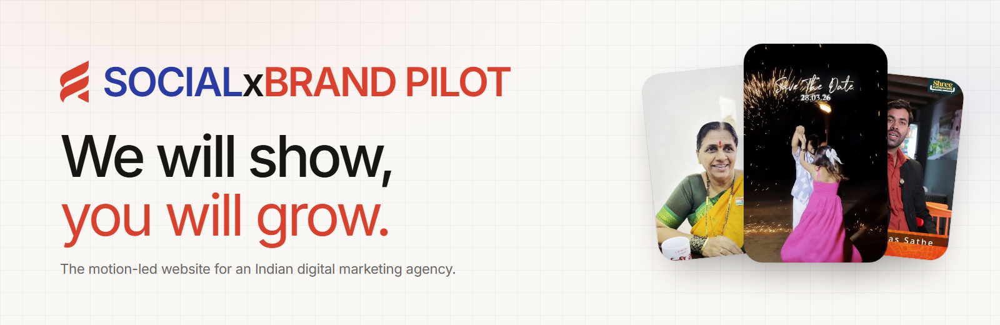
</p>

<p align="center">
  
  
  
  
  
  
  
</p>

<p align="center">
  <b>The motion-led website for SOCIALxBRAND PILOT, an Indian digital marketing agency.</b><br>
  The work is the hero: real reels play inside the headline and through the work,<br>
  all from the client's own footage. No stock footage, no invented figures.
</p>

<p align="center">
  <a href="#quick-start"><b>Quick start</b></a> ·
  <a href="#a-tour-of-the-home-page"><b>Tour</b></a> ·
  <a href="#how-it-is-built"><b>How it is built</b></a> ·
  <a href="#check-it-yourself"><b>Check it yourself</b></a> ·
  <a href="HANDOVER.md"><b>Handover</b></a>
</p>

<br>

<p align="center">
  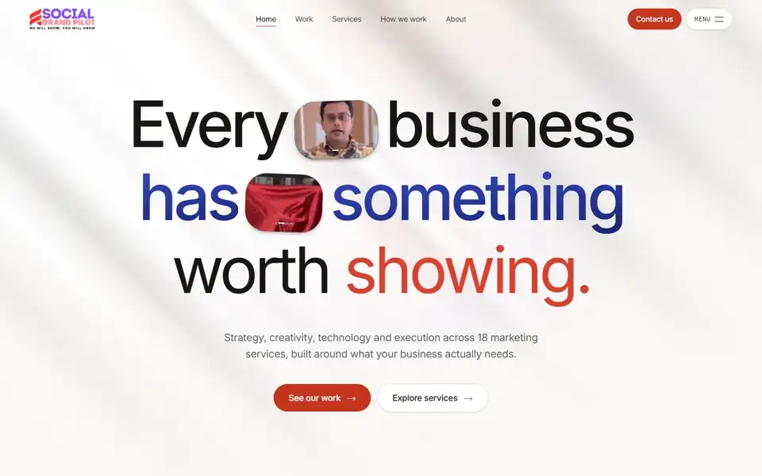
</p>
<p align="center">
  <sub>The hero. Capsules in the headline play the client's reels and roll to the next clip, above a plain line on what the agency does and the two ways in: the work and the services.</sub>
</p>

<details>
<summary><b>Table of contents</b></summary>

- [Why it is built this way](#why-it-is-built-this-way)
- [House rules](#house-rules)
- [A tour of the home page](#a-tour-of-the-home-page)
- [Every page](#every-page)
- [On a phone](#on-a-phone)
- [How it is built](#how-it-is-built)
- [Quick start](#quick-start)
- [Check it yourself](#check-it-yourself)
- [FAQ](#faq)
- [Documentation](#documentation)
- [Built with](#built-with)
- [Credits](#credits)

</details>

## Why it is built this way

An agency that promises *"We will show, you will grow"* has to show first. Most agency sites tell:
logos and numbers. This one shows the work itself, moving, from the first frame, then says plainly
what the agency does (18 services in four groups), how it works (four steps), who runs it and what
clients say. Motion carries the story, and the site still works completely with motion switched off.

## House rules

These are enforced in review and, where possible, by tests.

| Rule | How it holds |
|---|---|
| No invented content | No metrics, ROI, ratings, awards, prices or city. Every claim traces to `src/content/*`: the client's PDFs, plus the founder details and client feedback the owner supplied ([docs/content-map.md](docs/content-map.md)). A content audit test fails on proof-shaped text. |
| Real work only | All 95 media assets (43 reels) come from the client's Drive through `scripts/media/*`, credited *Production partner: Vishay Creations*. |
| Vertical stays vertical | 9:16 reels are never letterboxed. In landscape layouts they stand upright over their own blurred light. |
| Reduced motion and no-JS are complete | Every animated reveal has a static fallback and a CSS failsafe, so nothing stays hidden. |
| One motion grammar | Shared ease and duration tokens in `src/lib/motion/tokens.ts`, mirrored in CSS. |

<p align="right"><a href="#top">Back to top ↑</a></p>

## A tour of the home page

<table>
  <tr>
    <td width="50%">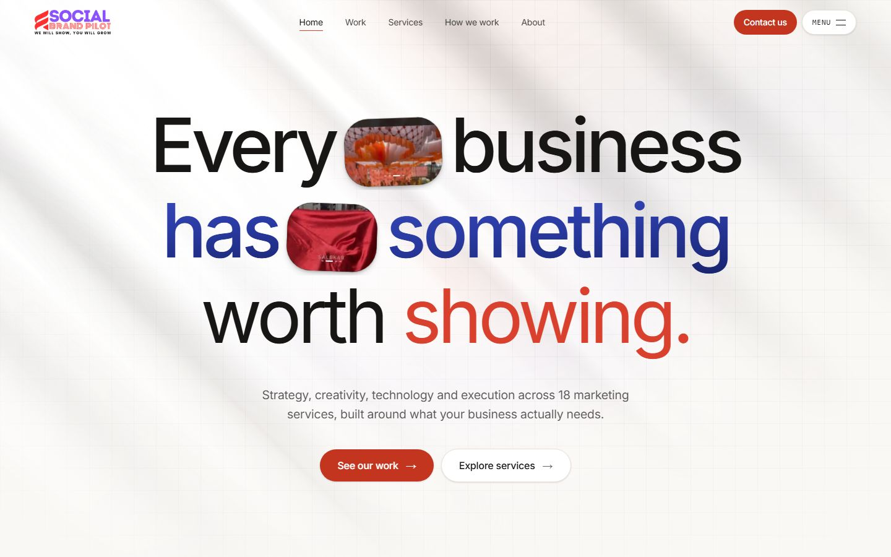</td>
    <td width="50%">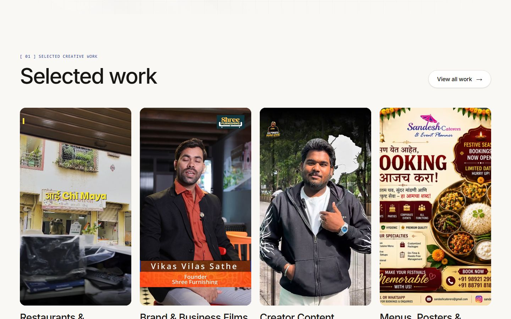</td>
  </tr>
  <tr>
    <td><sub><b>1 · Hero.</b> The brand line with the client's reels playing inside it, one sentence on what the agency does, and two ways in: the work and the services.</sub></td>
    <td><sub><b>2 · Selected work.</b> Four featured collections. Each card plays its clip while it is on screen and rests on its poster otherwise.</sub></td>
  </tr>
  <tr>
    <td>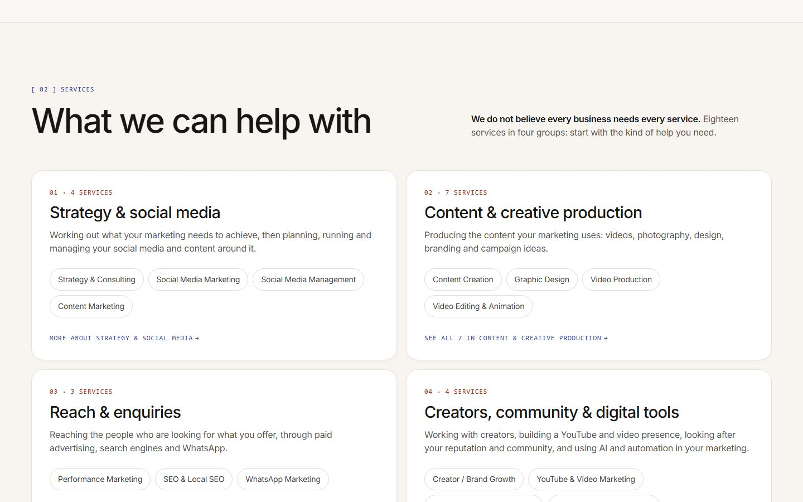</td>
    <td>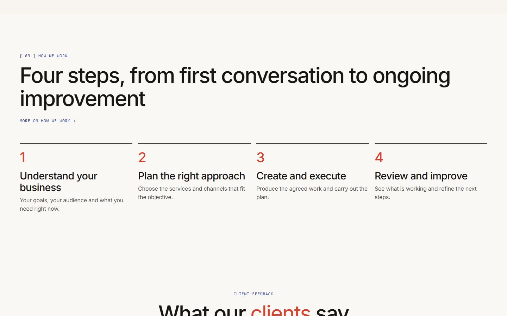</td>
  </tr>
  <tr>
    <td><sub><b>3 · Services.</b> The 18 services, grouped into four plain categories, each linking to its own page.</sub></td>
    <td><sub><b>4 · How we work.</b> Four steps, from understanding the business to reviewing and improving.</sub></td>
  </tr>
  <tr>
    <td colspan="2">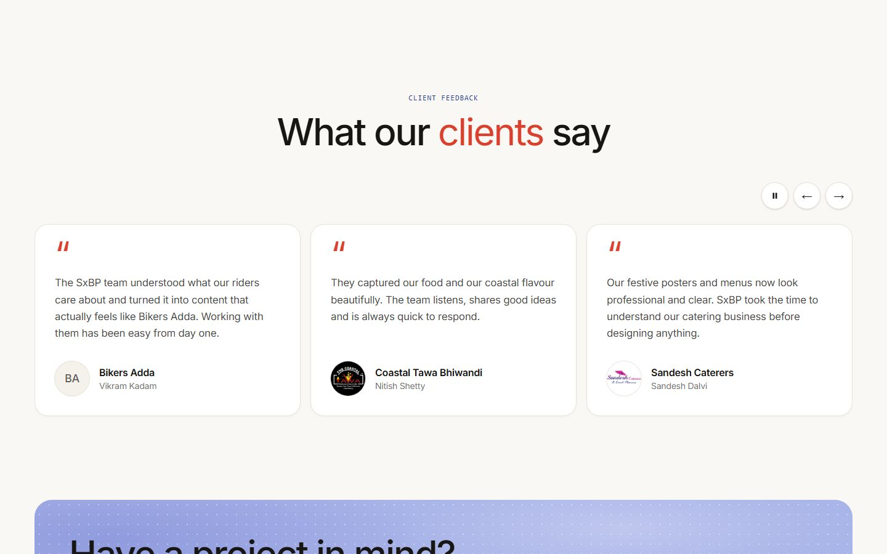</td>
  </tr>
  <tr>
    <td colspan="2"><sub><b>5 · Client feedback.</b> One card per client, with their logo. The row moves on by itself and can be paused; with reduced motion it holds still. Then a closing call to action.</sub></td>
  </tr>
</table>

<p align="right"><a href="#top">Back to top ↑</a></p>

## Every page

<table>
  <tr>
    <td width="50%">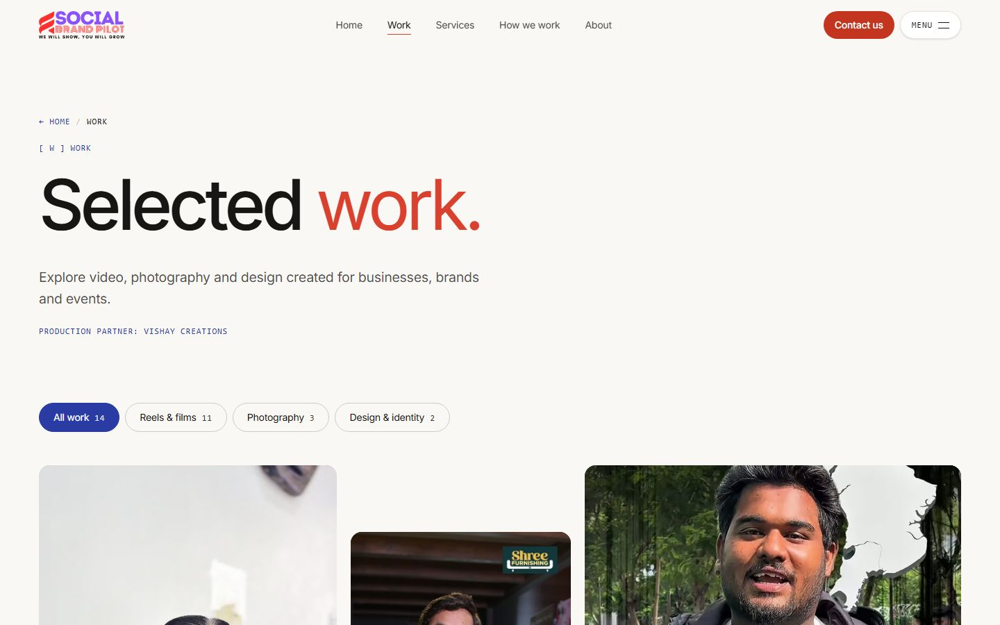</td>
    <td width="50%">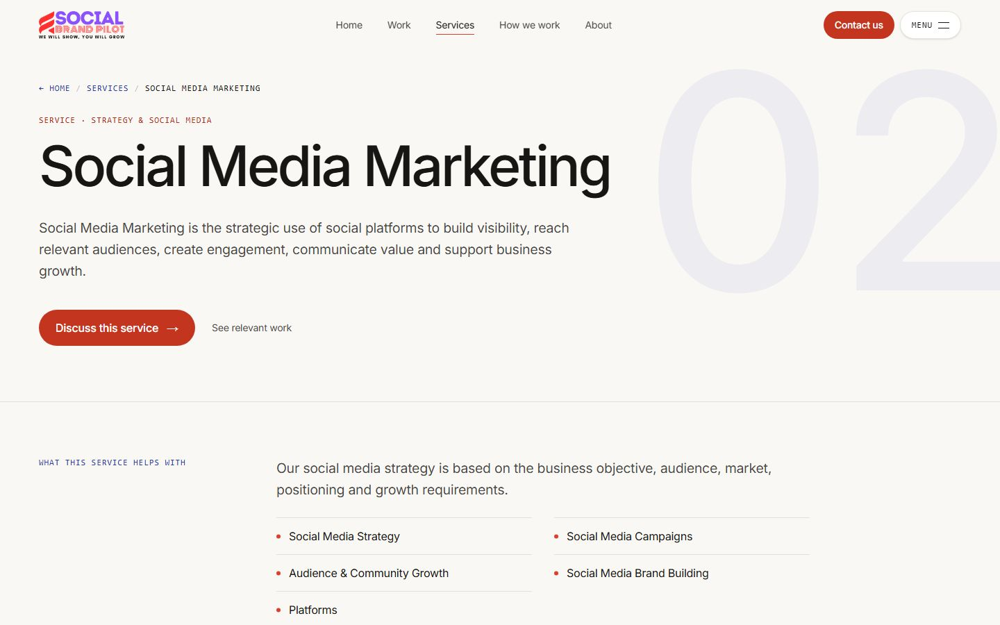</td>
  </tr>
  <tr>
    <td><sub><b>/work.</b> 14 work collections, filterable by format, each with its own page.</sub></td>
    <td><sub><b>/capabilities/…</b> One page per service: what it helps with, typical deliverables, how we work and related services.</sub></td>
  </tr>
  <tr>
    <td>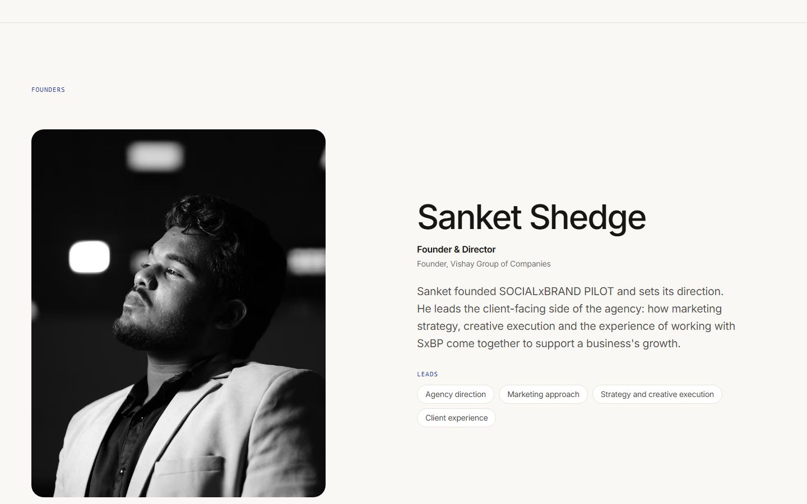</td>
    <td>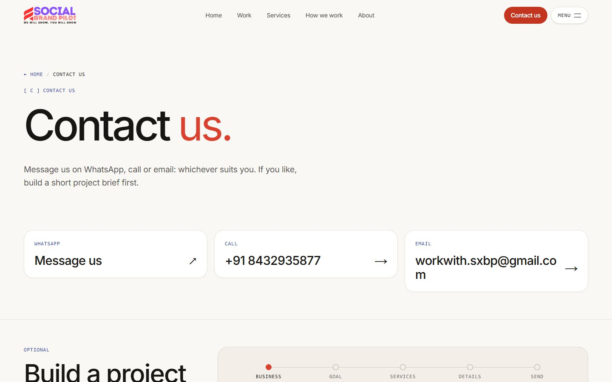</td>
  </tr>
  <tr>
    <td><sub><b>/about.</b> The two founders: portrait, role, what each of them leads.</sub></td>
    <td><sub><b>/route.</b> Contact: WhatsApp, call or email first, then an optional project brief the visitor sends from their own WhatsApp or email.</sub></td>
  </tr>
</table>

Every inner page opens with a breadcrumb trail and ends with a *Where to next?* band, so a visitor
who has finished reading never has to scroll back to find the way on.

## On a phone

<table>
  <tr>
    <td width="33%">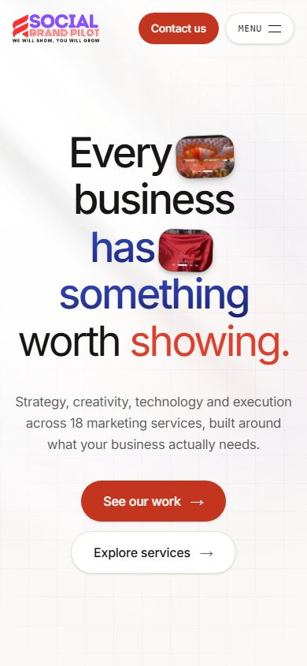</td>
    <td width="33%">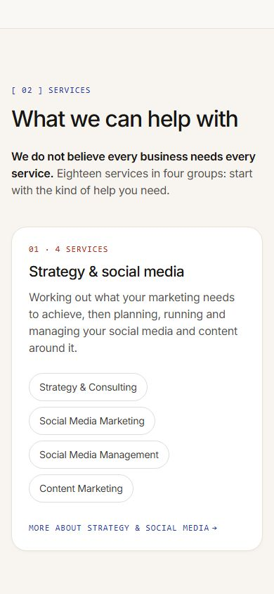</td>
    <td width="33%">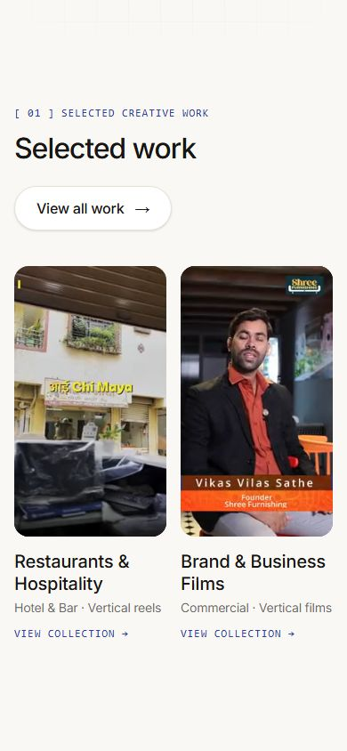</td>
  </tr>
</table>

Small screens get their own layout, not a shrunk desktop: the work cards use the lighter 360p clips,
at most two videos play at once, and the feedback row is swiped.

<p align="right"><a href="#top">Back to top ↑</a></p>

## How it is built

- **Next.js 16 App Router** with React 19 `<ViewTransition>` page transitions. Every route is
  statically generated.
- **GSAP 3.15** (ScrollTrigger, SplitText, Flip, CustomEase) driven through `gsap.matchMedia`, so desktop,
  phone and reduced motion each get their own timeline. One-shot reveals use IntersectionObserver,
  not a ScrollTrigger each.
- **Lenis** smooth scrolling on the GSAP ticker.
- **Tailwind CSS 4** with design tokens in `@theme`, plus custom variants: `cinema:` for desktop with
  motion, and `short:` for short laptop screens.
- **A video budget.** A shared cap on concurrent playback (3 on desktop, 2 on a phone), one cold start
  at a time, and posters until a reel is on screen. Reels download only when they are granted a slot.
- **Content as data.** The 18 services, the four steps, the work, the founders and the client feedback
  all live in `src/content/*`. The pages render from it.

```
src/
├─ app/          routes: home, work, capabilities, approach, about, route
├─ components/   home acts, sections, capabilities, work, route builder, layout, media, fx, motion
├─ content/      services, site profile, work collections, founders, client feedback, generated media index
└─ lib/          gsap registration, motion tokens, route store and adapters, SEO
```

```
docs/
├─ briefs/       the owner's audit and refactor briefs, as received
├─ reviews/      what was done for each brief, with measurements
├─ source/       client source material: PDFs, Drive inventory, original logos and photos
└─ assets/       README screenshots
public/
├─ brand/        logos used by the site
├─ media/        transcoded work (generated by scripts/media)
├─ clients/      feedback logos (generated by scripts/media/feedback-logos.mjs)
└─ founders/     founder portraits (generated by scripts/media/founders.mjs)
```

## Quick start

On Windows, double-click `startup.bat`. It installs dependencies when needed, starts the site on
http://localhost:3100 and opens your browser. Run `startup.bat help` for options.

Anywhere else:

```bash
npm install
npm run dev -- --port 3100
```

```bash
npm run build
npm start
```

<p align="right"><a href="#top">Back to top ↑</a></p>

## Check it yourself

The test suite covers content integrity, accessibility (axe), reduced motion, media loading, the
contact flow and one regression guard per fixed audit item. Run it against a production build:

```bash
npm run build && npm start -- --port 3102
PORT=3102 npx playwright test --workers=1
```

```text
  85 passed · 62 skipped (run-once tests skip on the other two viewports)
```

QA scripts in `scripts/qa/` drive a real browser against a server on port 3100 (`QA_BASE` or `--base=` for another):

| Script | What it proves |
|---|---|
| `sweep.mjs` | Every route at six viewports, no horizontal overflow, no page errors (add `--reduce` for reduced motion) |
| `record.mjs` | Records a scroll-through video of each route and logs every console error, failed request and 4xx |
| `check-shift.mjs` | Layout stability: layout shift (CLS) and page height, idle and while scrolling |
| `check-flow.mjs` | No dead ends: the nav, a Home link and onward links are on screen at the end of every page |
| `perf.mjs` | Load metrics and scroll smoothness under CPU throttling (production build only) |
| `media-audit.mjs` | Videos mounted and playing, video requests and bytes per route |

The images in this README are produced the same way: `node scripts/readme/capture.mjs`.

## FAQ

<details>
<summary><b>Where do the videos and photos come from?</b></summary>
<br>
The client's Google Drive. <code>scripts/media/</code> inventories it, builds contact sheets for
curation, downloads the selection and transcodes it to AV1/H.264 previews and AVIF/WebP posters.
Nothing is stock or generated.
</details>

<details>
<summary><b>What happens with reduced motion turned on?</b></summary>
<br>
Every section renders complete and still. Nothing cycles or loops on its own: reels and the hero
capsules show their poster frame, and the feedback row stays where the visitor puts it.
</details>

<details>
<summary><b>Can I change the copy?</b></summary>
<br>
Yes. Edit <code>src/content/*</code>. The services, steps, site profile, founders and feedback are plain
typed data, and the content audit test checks that the 18 service names still match the client's document.
</details>

<details>
<summary><b>How does a visitor get in touch?</b></summary>
<br>
The Contact page puts WhatsApp, call and email first. Below them, an optional project brief (who
they are, what they need, which services) is sent from the visitor's own WhatsApp or email, or
copied. The site itself sends and stores nothing.
</details>

<details>
<summary><b>I am picking this up in a new session. Where do I start?</b></summary>
<br>
<a href="HANDOVER.md">HANDOVER.md</a> has the status, the design system, the gotchas and the next
steps. <a href="AGENTS.md">AGENTS.md</a> has the project rules.
</details>

## Documentation

| Document | What it covers |
|---|---|
| [HANDOVER.md](HANDOVER.md) | Current status, design system, history, gotchas and next steps |
| [AGENTS.md](AGENTS.md) | The non-negotiables, commands and map for anyone editing the code |
| [docs/design-brief.md](docs/design-brief.md) | The creative direction |
| [docs/motion-system.md](docs/motion-system.md) | Motion tokens, the grammar and the reduced-motion rules |
| [docs/site-architecture.md](docs/site-architecture.md) | Routes, components and data flow |
| [docs/content-map.md](docs/content-map.md) | Where every piece of copy comes from in the client's PDFs |
| [docs/merge-sujal-site.md](docs/merge-sujal-site.md) | What was taken from the earlier prototype, and what was left out |
| [docs/briefs/](docs/briefs/) | The current brief; finished ones in `archive/` |
| [docs/reviews/](docs/reviews/) | The report for each brief: findings, changes and measurements |

## Built with

<p>
  
  
  
  
  
  
  
</p>

## Credits

All work shown belongs to **SOCIALxBRAND PILOT** and its clients. Production partner: **Vishay Creations**.
Typeface: Inter. Platform marks in the hero orbit from [Simple Icons](https://simpleicons.org).

<p align="right"><a href="#top">Back to top ↑</a></p>
